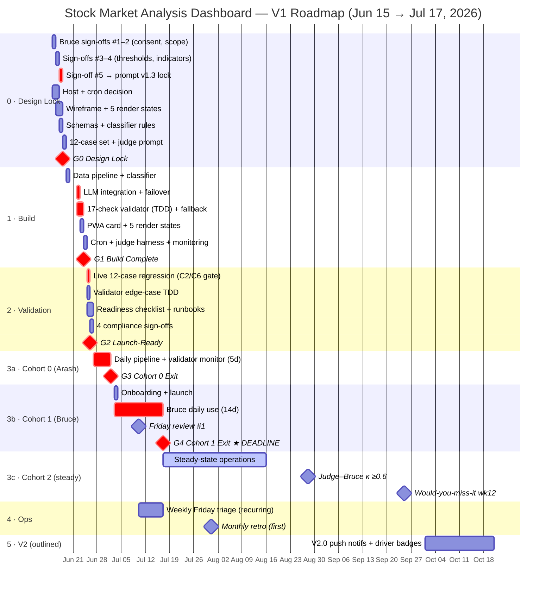

# Gantt Chart — Stock Market Analysis Dashboard (Daily Conversation Briefing)

**Kickoff:** Mon Jun 15, 2026 · **Hard deadline ★:** steady state by **Fri Jul 17, 2026** · **Source:** [Product Plan.md](Product%20Plan.md)

> Render note: the diagram below is a [Mermaid](https://mermaid.js.org) `gantt`. It draws automatically in GitHub, GitLab, VS Code (with a Mermaid extension), Obsidian, and Notion. If your viewer does not render Mermaid, use the **plain-text schedule table** further down — it carries the same data.
> Convention: Design/Build/Validation run on business days; Cohort phases run on calendar days (cron + Bruce usage are daily, incl. weekends), so the chart intentionally does **not** exclude weekends.

---

## Plain-text schedule (same data, no Mermaid required)

Owner key: **A** = Arash · **B** = Bruce. ◆ = gate · ★ = hard deadline.

| Phase | ID | Task | Owner | Start | End | Dur | Gate |
|-------|----|------|-------|-------|-----|-----|------|
| 0 Design | D1 | Sign-off #1 consent + first-name | B | Jun 15 | Jun 15 | 1d | |
| 0 Design | D2 | Sign-off #2 banned-phrase + scope | B | Jun 15 | Jun 15 | 1d | |
| 0 Design | D3 | Sign-off #3 regime thresholds | A→B | Jun 16 | Jun 16 | 1d | |
| 0 Design | D4 | Sign-off #4 indicator list | A→B | Jun 16 | Jun 16 | 1d | |
| 0 Design | D5 | Sign-off #5 tone → prompt v1.3 lock | A→B | Jun 17 | Jun 17 | 1d | |
| 0 Design | D6 | Host + cron decision | A | Jun 15 | Jun 16 | 2d | |
| 0 Design | D7 | Wireframe + 5 render states | A | Jun 16 | Jun 17 | 2d | |
| 0 Design | D8 | Lock schemas + plausibility ranges | A | Jun 17 | Jun 17 | 1d | |
| 0 Design | D9 | Lock classifier rules | A | Jun 17 | Jun 17 | 1d | |
| 0 Design | D10 | Finalize 12-case regression set | A | Jun 18 | Jun 18 | 1d | |
| 0 Design | D11 | Draft LLM-judge prompt | A | Jun 18 | Jun 18 | 1d | |
| — | **◆G0** | **Design Lock** | A+B | Jun 18 | Jun 18 | — | ◆ |
| 1 Build | B1 | Data pipeline + cache + plausibility | A | Jun 19 | Jun 19 | 1d | |
| 1 Build | B2 | Deterministic classifier impl | A | Jun 19 | Jun 19 | 1d | |
| 1 Build | B3 | LLM integration + Groq failover | A | Jun 22 | Jun 22 | 1d | |
| 1 Build | B4 | 17-check validator (TDD) + fallback | A | Jun 22 | Jun 23 | 2d | |
| 1 Build | B5 | PWA rows + briefing card + states | A | Jun 23 | Jun 23 | 1d | |
| 1 Build | B6 | Cron runner + secrets | A | Jun 24 | Jun 24 | 1d | |
| 1 Build | B7 | LLM-judge harness | A | Jun 24 | Jun 24 | 1d | |
| 1 Build | B8 | Monitoring stack | A | Jun 24 | Jun 24 | 1d | |
| 1 Build | B9 | E2E integration + buffer | A | Jun 24 | Jun 24 | 1d | |
| — | **◆G1** | **Build Complete** | A | Jun 24 | Jun 24 | — | ◆ |
| 2 Valid. | V1 | Live 12-case regression (C2/C6 gate) | A | Jun 25 | Jun 25 | 1d | |
| 2 Valid. | V2 | Validator edge-case TDD | A | Jun 25 | Jun 25 | 1d | |
| 2 Valid. | V3 | 23-item readiness checklist | A | Jun 25 | Jun 26 | 2d | |
| 2 Valid. | V4 | 8 operational runbooks | A | Jun 26 | Jun 26 | 1d | |
| 2 Valid. | V5 | 4 compliance sign-offs | B | Jun 26 | Jun 26 | 1d | |
| — | **◆G2** | **Launch-Ready** | A+B | Jun 26 | Jun 26 | — | ◆ |
| 3a Coh.0 | C0.1 | Daily pipeline + validator monitor | A | Jun 27 | Jul 1 | 5d | |
| 3a Coh.0 | C0.2 | Live regression on real data | A | Jun 27 | Jul 1 | 5d | |
| — | **◆G3** | **Cohort 0 Exit** | A | Jul 2 | Jul 2 | — | ◆ |
| 3b Coh.1 | C1.0 | Onboarding + launch SMS | A | Jul 3 | Jul 3 | 1d | |
| 3b Coh.1 | C1.1 | Bruce daily use (14d) | B | Jul 3 | Jul 16 | 14d | |
| 3b Coh.1 | C1.2 | Friday review #1 | A+B | Jul 10 | Jul 10 | — | |
| 3b Coh.1 | C1.3 | Friday review #2 + promotion | A+B | Jul 17 | Jul 17 | — | |
| 3b Coh.1 | C1.4 | Bruce 10% weekly ratings | B | Jul 3 | Jul 16 | 14d | |
| — | **◆G4 ★** | **Cohort 1 Exit — DEADLINE** | A+B | **Jul 17** | **Jul 17** | — | ◆★ |
| 3c Coh.2 | C2.1 | Steady-state operations | A | Jul 17 | ongoing | — | |
| 3c Coh.2 | M-κ | Judge–Bruce κ ≥0.6 | A+B | — | ~Aug 28 | — | |
| 3c Coh.2 | M-miss | "Would you miss it?" wk 4/8/12 | B | — | ~Sep 25 | — | |
| 3c Coh.2 | M-healthy | 6-month healthy target | A+B | — | ~Jan 2027 | — | |
| 4 Ops | O1 | Weekly Friday triage | A+B | Jul 10 | recurring | — | |
| 4 Ops | O2 | Monthly retro | A+B | ~Jul 31 | recurring | — | |
| 4 Ops | O3 | Quarterly recalibration | A+B | ~Oct 2026 | recurring | — | |
| 5 V2 | V2.0 | Push notifs + driver badges | A+B | ~Q4 2026 | — | — | |

---

## Legend & critical path

- **◆ Gate** — must pass to proceed. **★** — Jul 17 hard deadline (steady-state entry).
- **Owners:** A = Arash (build + ops), B = Bruce (sign-offs + daily use + reviews).
- **Critical path (single-threaded after G2):**
  `G0 → B3 LLM → B4 validator → V1 live regression → G2 → Cohort 0 → G3 → Cohort 1 → G4 ★`
- **Highest-risk nodes:** V1 (live regression must measure C2=5/5, C6=5/5, mean ≥4.0) and G3 (validator ≥85% on real data). A miss at either triggers a v1.3 fix sprint and puts Jul 17 at risk — in which case extend the date rather than shorten the 14-day Cohort 1.
